# Mac Notche

Die Notch als Schaltzentrale für den Mac – auch auf Macs ohne Notch (Mac Studio, Mac mini, externe Monitore). Alles frei, kein Abo, keine Sperren.

**[Download: Mac Notche 4.9.dmg](../../releases/latest)** · macOS 14.2 oder neuer · Apple Silicon

## Funktionen

**Zugeklappt:** Musik-Cover und Equalizer, Temperatur, Timer-Countdown, Claude-Limits in Prozent (5 Stunden, wo der Plan eines hat, und Woche).

**Aufgeklappt, nach Reitern:**

| Reiter | Inhalt |
|---|---|
| Übersicht | Musik mit Steuerung, Lautstärke (System und pro App), Termine, Erinnerungen, Akkus von Maus, Tastatur, AirPods und iPhone mit Verlauf, Aktienkurse, Sport-Ergebnisse, Kurzbefehle |
| Mitteilungen | Mitteilungen des Macs, Antworten auf iMessage und SMS direkt aus der Notch |
| Wetter | Aktuell und Vorhersage (Open-Meteo, ohne Schlüssel) |
| KI | Claude-Plan-Limits, Token und Kosten von Claude Code, Codex (ChatGPT-Limits) und Gemini über Antigravity CLI |
| Fragen | Claude, Gemini (Antigravity), ChatGPT (Codex) oder per API-Schlüssel Grok, Perplexity, Mistral fragen; Text-Werkstatt (⌥⌘T): kopierten Text umschreiben, kürzen, übersetzen und zurück einfügen – als Text, mit Bildschirmfoto, oder als Aufgabe (Claude plant Schritte, du bestätigst, die App führt aus) |
| Notiz | Schnellnotiz mit Diktat (Apple-Spracherkennung, lokal), sichern in Apple Notizen oder als Markdown in einen Ordner |
| Ablage | Dateien ablegen, umwandeln (PNG/JPEG/HEIC), DMG installieren, per AirDrop senden; Freistellen (⌥⌘4): Bildschirmbereich aufziehen, Text wird erkannt und kopiert, das Bild liegt in der Ablage |
| iPhone | Name, Akku und neue Fotos per Kabel oder über WLAN (Finder-WLAN-Sync + libimobiledevice), Übernahme in die Fotos-App |
| Fokus | Timer (auch per Text im Reiter Fragen: „15 min Tee“ läuft in der Leiste), Fokus 25+5, braunes Rauschen, Augen- und Trinkpause, Ton-Ausgabe, Lautstärke pro App, Notizen |
| Zuhause | HomeKit über Kurzbefehle: Szenen und Geräte als Kacheln (Ordner „Zuhause“ oder Stichwörter) |
| Werkzeuge | Spiegel (Kamera), Wach halten, Zwischenablage-Verlauf |

## Bilder

| | |
|---|---|
|  Zugeklappt als Katze: Musik, KI-Kontingent |  Angedockt mit weichen Ohren |
| 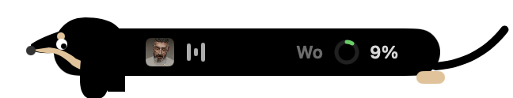 Dackel |  Bulldogge |
| 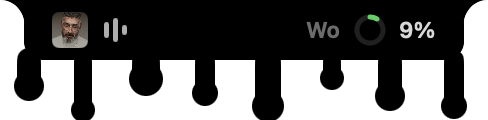 Tropfend | 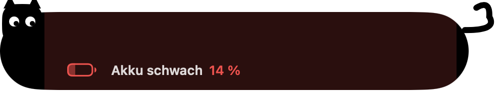 Meldung: Akku schwach |
|  Meldung: Download fertig | 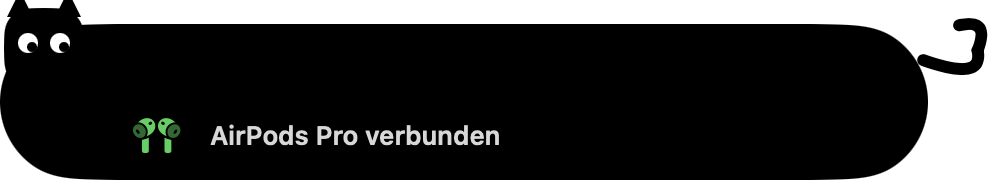 Meldung: AirPods verbunden |

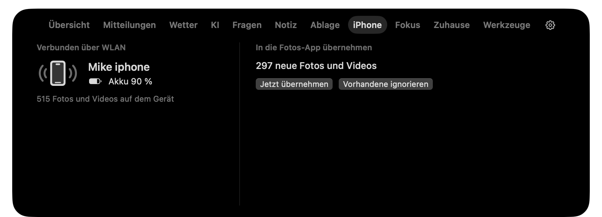
*iPhone über WLAN: Name, Akku, neue Fotos in die Fotos-App übernehmen*

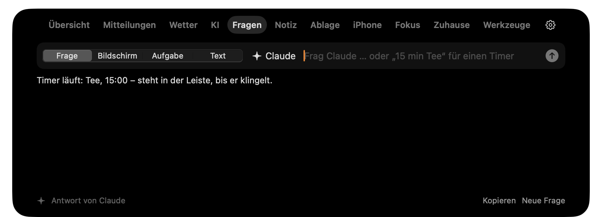
*Reiter Fragen: „15 min Tee“ startet einen Timer, sonst antwortet die gewählte KI*

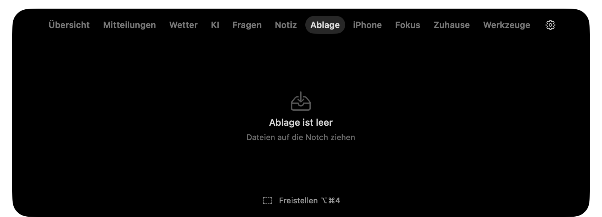
*Ablage mit Freistellen (⌥⌘4): Bildschirmbereich aufziehen, Text wird erkannt und kopiert*

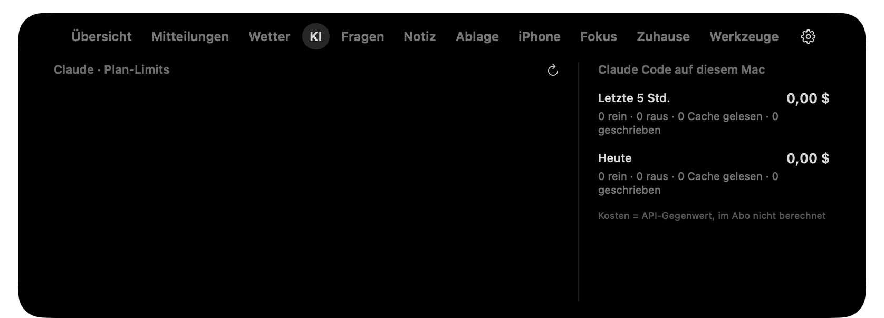
*Reiter KI: Kontingente und Token von Claude, Codex und Antigravity*

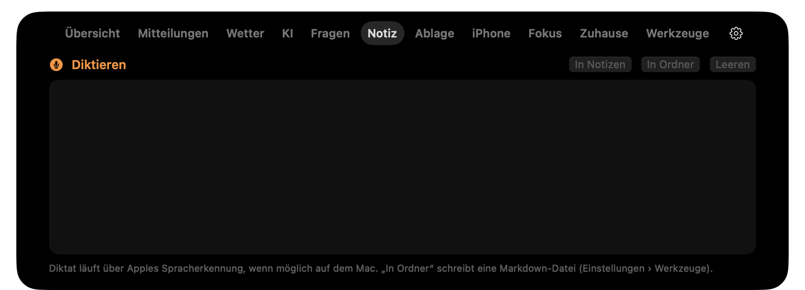
*Reiter Notiz: Diktat, in Apple Notizen oder als Markdown in einen Ordner*

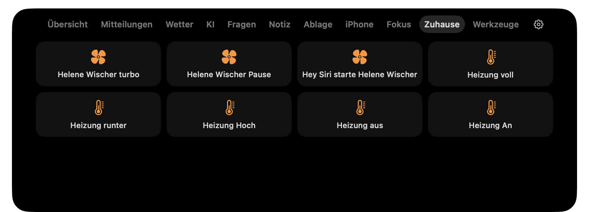
*Reiter Zuhause: Kurzbefehle aus der Kurzbefehle-App als Kacheln*

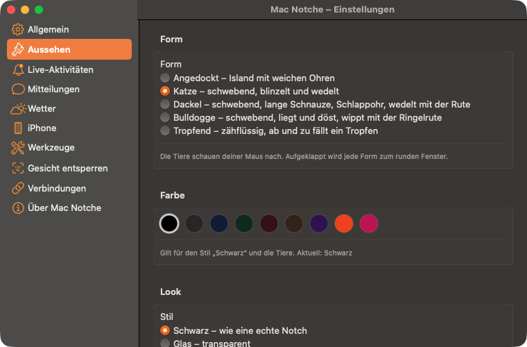
*Einstellungen › Aussehen: Form und Farbe*

**Formen (Einstellungen › Aussehen):** Angedockt (Island mit Ohren), Katze, Dackel und Bulldogge (schwebend, blinzeln, wedeln, schauen der Maus nach), Tropfend; Körperfarbe wählbar (Schwarz, Anthrazit, Nachtblau, Tannengrün, Weinrot, Schokolade, Lila, Signalorange, Pink).

**Im Hintergrund:** Lautstärke- und Feststell-Anzeige, Bluetooth- und Akku-Meldungen, Termin-Hinweis, Termin-Countdown in der zugeklappten Notch (ab 60 Min. vorher, ab 10 Min. orange, Klick öffnet Zoom/Teams/Meet), Downloads-Wächter (neue Datei → Meldung und Ablage), Fenster einrasten (per ⌃⌥-Tastenkürzel oder Ziehen an den Rand), Textbausteine und Emoji-Kürzel (`;mfg`, `:herz:`), Menüleisten-Symbole ausblenden, Bildschirmecken mit Aktionen, Gesicht entsperren.

## Bauen

```bash
./bauen.sh      # build/Mac Notche.app
./dmg.sh        # ../Mac Notche <Version>.dmg
```

Braucht Xcode-Kommandozeilenwerkzeuge. `bauen.sh` signiert mit dem Zertifikat aus `KERBE_IDENTITAET` oder ad hoc.

Zum Prüfen ohne Maus: `open -a "Mac Notche" --args --zeige Fokus`, `--seite werkzeuge`, `--selbsttest` (im Terminal direkt über das Binary).

## Erlaubnisse

Jede Funktion fragt erst, wenn du sie nutzt: Kalender, Erinnerungen, Kontakte, Kamera, Bluetooth, Festplattenvollzugriff (Mitteilungen), Bedienungshilfen (Fenster, Textbausteine), Bildschirmaufnahme (Bildschirm-Frage), Systemaudio (Lautstärke pro App).

Claude-Funktionen laufen über eine lokale Claude-Code-Anmeldung (`claude` im Terminal), ohne API-Schlüssel.

## Hinweise

- Das Gesichtsmodell `Gesicht.mlmodelc` ist ein FaceNet-Modell in Core ML. Es läuft komplett auf dem Mac, nichts verlässt das Gerät.
- Die App ist mit einem Entwicklerzertifikat signiert, aber nicht notarisiert. Beim ersten Start: Rechtsklick › Öffnen.

made with ♥ by [Mike Hillebrand Media](https://mikehillebrand.com) · MIT-Lizenz
